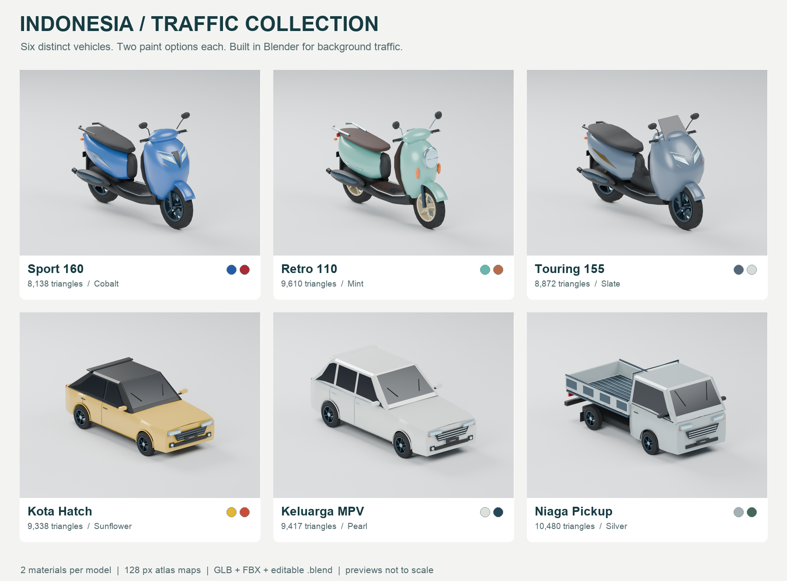

# Indonesian traffic vehicle collection

Six original lightweight vehicle designs, made for background traffic in the Indonesian driving game. Three scooter shapes and three four-wheel vehicles, each with two paint options. These are simplified, fictional designs with approximate proportions inspired by familiar Indonesian vehicles, not exact manufacturer replicas. All meshes and material atlases are newly authored; no marketplace models or reference-photo textures are included.



| Vehicle | Paint options | Main triangles | LOD1 triangles | Export meshes |
|---|---|---:|---:|---:|
| [Sport 160](sport_scooter/sport_scooter.blend) | Cobalt, Crimson | 8,138 | 3,482 | 7 |
| [Retro 110](retro_scooter/retro_scooter.blend) | Mint, Terracotta | 9,610 | 4,118 | 7 |
| [Touring 155](maxi_scooter/maxi_scooter.blend) | Slate, Pearl | 8,872 | 3,797 | 7 |
| [Kota Hatch](city_hatchback/city_hatchback.blend) | Sunflower, Coral | 9,338 | 4,008 | 8 |
| [Keluarga MPV](family_mpv/family_mpv.blend) | Pearl, Deep Blue | 9,417 | 4,042 | 8 |
| [Niaga Pickup](utility_pickup/utility_pickup.blend) | Silver, Forest | 10,480 | 4,527 | 8 |

All six use two materials: `Body_Paint` and `Traffic_Atlas_PBR`. Four 128 × 128 atlas maps contain base color, roughness, metallic and emission. Windows and scooter windscreens use opaque dark glass coloring for inexpensive traffic rendering. The preview lighting is a Blender studio and is excluded from model exports.

## Files and paint options

Each vehicle directory includes:

- Editable `.blend` with named component meshes, packed textures, studio lights and a camera.
- Two main `.glb` files, one for each paint, with embedded textures.
- Two `_lod1.glb` files, retaining the same animation hierarchy with reduced geometry.
- One `.fbx` in the first paint color, with embedded atlas textures.
- `textures/` with the standalone PBR maps.
- `previews/` with both colors, the rear view and an actual re-imported LOD1 render.
- `asset_stats.json` with triangle counts, bounds, wheel centers and radii.

`manifest.json` lists exact asset paths, colors and dimensions for integration. `alternate_colors.png` shows the second set of paint options; `lod_options.png` shows the re-imported LODs. Comparison sheets normalize framing for readability; vehicles retain different real-world scales in the files.

To recolor the FBX or Blender model, edit `Body_Paint` Base Color. The two supplied hex colors are in `manifest.json`; roughness is 0.32 and metallic is 0.22. The second paint option uses the same geometry. The atlas contents are identical across all six models and may share one engine material after import.

## Unity / engine handoff

Geometry uses meters. Blender: +Y forward, +Z up. GLB: -Z forward, +Y up. The ground origin lies between the axles. For a controller expecting +Z forward, rotate the imported model root by 180 degrees around the up axis; check FBX import conversion in the Inspector.

Exported empties have an `_Export` suffix. Wheels are separate meshes, with their origins at their axles. Rotate wheel pivots around local X. Rotation angle in radians is travel distance divided by the radius in `manifest.json`.

- Scooters: `Steering_Pivot` parents `Wheel_Front`, the fork, fender, handlebar and mirrors. Turn the steering around Blender Z / GLB Y. `Wheel_Rear` is independent. `Socket_Rider`, `Socket_Passenger` and `Socket_Grip_L/R` provide placement guides.
- Cars: `Steering_FL` and `Steering_FR` parent the corresponding `Wheel_FL/FR`; `Wheel_RL/RR` are independent. Both steering centers are at the front axles. `Socket_Driver` is on the right side, with a passenger socket on the left.
- `Headlights`, `TailLights` and `Indicators` are separate mesh groups. The atlas is shared; changing its emission affects every object using that material. To animate lamps independently, use a dedicated material override for the lamp group. Left and right indicators are grouped together in this lightweight pack and require separating for independent turn signals.

For Unity's FBX path, the importer may need a URP/Lit material assigned manually. Use the atlas base-color map, and treat metallic and roughness maps as linear data. Unity's smoothness is the inverse of roughness; repack it into the appropriate channel for your chosen shader. GLB carries the PBR setup for compatible importers. Opaque window surfaces require no transmission shader.

Choose LOD distances in the target game and profile the actual traffic count. Triangle counts alone do not establish a frame-rate guarantee. This pack contains vehicle art and rigid-part pivots; driving physics, traffic AI, detailed interiors, riders, passengers, collisions and Unity prefabs belong to the integration step. Doors and pickup gates are static body geometry.

The finalized red/white BeAT is a separate asset and is not modified by this pack. No Unity files are changed here.

## Validation and reproducibility

`validation.json` records round-trip checks for all 30 exports (24 GLBs and six FBXs): finite and valid geometry, UVs, meter scale, ground contact, wheel centers and spin, lamp groups, embedded GLB atlas maps and correct paint colors. Each entry includes the SHA-256 of the validated file. LOD1 files are also re-imported and rendered for visual review.

Run on this laptop from the repository root:

```sh
/Applications/Blender.app/Contents/MacOS/Blender --background --factory-startup --python assets/vehicles/indonesia_traffic_pack/build.py
/Applications/Blender.app/Contents/MacOS/Blender --background --factory-startup --python assets/vehicles/indonesia_traffic_pack/validate.py
/Applications/Blender.app/Contents/MacOS/Blender --background --factory-startup --python assets/vehicles/indonesia_traffic_pack/render_lods.py
```

Append `-- sport_scooter` (or another model ID from the manifest) to rebuild only one vehicle. Run `package.py` using Python with Pillow installed to regenerate comparison sheets, documentation, the manifest and ZIP after validation. Authoring scripts run in their own Blender process; they reset that process's scene.

## Visual references

Reference pages consulted 7 November 2026. Names below describe inspiration, while the supplied assets use fictional names and simplified geometry.

- Sport 160: [Honda Vario 160](https://www.astra-honda.com/product/vario-160), angular commuter scooter silhouette.
- Retro 110: [Honda Scoopy](https://www.astra-honda.com/product/scoopy), rounded apron, compact wheels and retro lamp treatment.
- Touring 155: [Yamaha NMAX](https://www.yamaha-motor.co.id/product/nmax-turbo/), broad fairing, center tunnel and stepped seat.
- Kota Hatch: [Honda Brio](https://www.honda-indonesia.com/Brio), compact five-door proportions and contrasting roof.
- Keluarga MPV: [Toyota Avanza](https://www.toyota.astra.co.id/product/9), taller three-window family-car silhouette.
- Niaga Pickup: [Suzuki New Carry](https://www.suzuki.co.id/news/suzuki-new-carry-jadi-pilar-andalan-wirausaha?page=0), cab-forward layout and open cargo bed.

Number plates are fictional placeholder artwork. Hidden surfaces and details are inferred and simplified for traffic use.
